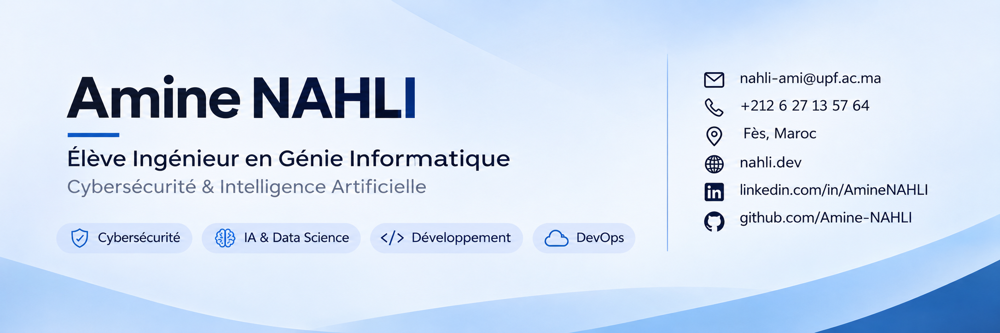
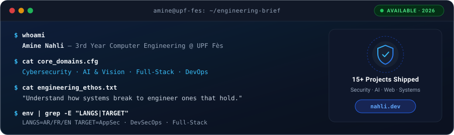
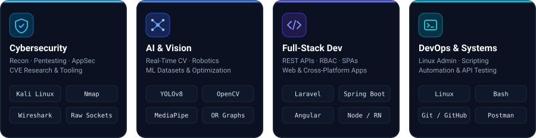
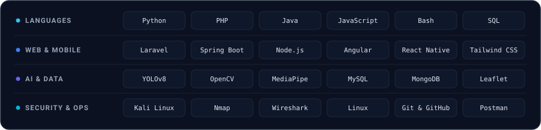

<!--
  AMINE NAHLI — GITHUB PROFILE README
  Self-contained visual assets in .github/assets/ (zero broken external stat cards)
-->

<!-- ════════════════════════ HERO BANNER ════════════════════════ -->

  

<!-- ════════════════════════ QUICK CONNECT ════════════════════════ -->

  
  &nbsp;
  
  &nbsp;
  
  &nbsp;
  

 

<!-- ════════════════════════ ENGINEERING BRIEF ════════════════════════ -->

## Engineering Brief

  

 

<!-- ════════════════════════ CORE DOMAINS ════════════════════════ -->

## Core Engineering Pillars

  

 

<!-- ════════════════════════ FEATURED PROJECTS ════════════════════════ -->

## Featured Projects

### 01 · Cybersecurity & Network Engineering

<table>
  <tr>
    <td width="50%" valign="top">
      <h4><a href="https://github.com/Amine-NAHLI/smart-network-mapper">smart-network-mapper</a></h4>
      
Network scanner enhanced with an <strong>AI vulnerability-detection layer</strong>. Discovers live hosts, open ports, and services across subnets to generate structured security reports.

      <code>Python</code> · <code>Nmap</code> · <code>AI</code> · <code>MIT</code>
    </td>
    <td width="50%" valign="top">
      <h4><a href="https://github.com/Amine-NAHLI/port-scanner-python">port-scanner-python</a></h4>
      
TCP/UDP port scanner built <strong>from raw sockets</strong> with zero Nmap dependency. Supports banner grabbing, real-time progress output, and structured result export.

      <code>Python</code> · <code>Raw Sockets</code> · <code>CLI</code>
    </td>
  </tr>
  <tr>
    <td width="50%" valign="top">
      <h4><a href="https://github.com/Amine-NAHLI/cve-dataset-generator">cve-dataset-generator</a></h4>
      
Automated data pipeline querying the live <strong>NVD API</strong> to parse, clean, and structure vulnerability intelligence into ML-ready training datasets.

      <code>Python</code> · <code>NVD API</code> · <code>Machine Learning</code>
    </td>
    <td width="50%" valign="top">
      <h4><code>security-portfolio</code> &nbsp;(Private)</h4>
      
Curated offensive security vault containing <strong>CTF writeups</strong>, custom enumeration scripts, penetration testing notes, and vulnerability research.

      <code>Python</code> · <code>Bash</code> · <code>Security Research</code> · <em>Available on request</em>
    </td>
  </tr>
</table>

### 02 · Full-Stack & Mobile Platforms

<table>
  <tr>
    <td width="50%" valign="top">
      <h4><a href="https://github.com/Amine-NAHLI/hopital-app">hopital-app</a></h4>
      
End-to-end hospital management platform covering patient records, doctors, scheduling, and strict <strong>role-based access control (RBAC)</strong>.

      <code>Laravel</code> · <code>Blade</code> · <code>MySQL</code>
    </td>
    <td width="50%" valign="top">
      <h4><a href="https://github.com/Amine-NAHLI/gestion-stock-commerce">gestion-stock-commerce</a></h4>
      
Inventory, order, and supplier management platform for SMBs built with a decoupled <strong>Spring Boot REST API</strong> and <strong>Angular SPA</strong>.

      <code>Spring Boot</code> · <code>Angular</code> · <code>MIT</code>
    </td>
  </tr>
  <tr>
    <td width="50%" valign="top">
      <h4><a href="https://github.com/Amine-NAHLI/geoalert">geoalert</a></h4>
      
Crowdsourced <strong>real-time road incident reporting</strong> app allowing drivers to flag hazards and accidents on an interactive Leaflet map.

      <code>Node.js</code> · <code>Express</code> · <code>MongoDB</code> · <code>Leaflet</code>
    </td>
    <td width="50%" valign="top">
      <h4><a href="https://github.com/Amine-NAHLI/recette-du-monde-avec-API-mobile-expo">recette-du-monde</a></h4>
      
Cross-platform mobile application for browsing global cuisines, filtering recipes via REST API, and managing saved favorites.

      <code>React Native</code> · <code>Expo</code> · <code>REST API</code>
    </td>
  </tr>
  <tr>
    <td width="50%" valign="top">
      <h4><a href="https://github.com/Amine-NAHLI/gestion-etudiants-PHP">gestion-etudiants-PHP</a></h4>
      
Academic management system handling student enrollment, grades, modules, and administration — engineered in <strong>pure PHP</strong> with zero frameworks.

      <code>PHP</code> · <code>MySQL</code> · <code>Vanilla Architecture</code>
    </td>
    <td width="50%" valign="top">
      <h4><a href="https://github.com/Amine-NAHLI/look-me">look-me</a></h4>
      
Modern fashion <strong>e-commerce</strong> web application featuring product catalog browsing, shopping cart state, authentication, and checkout flow.

      <code>JavaScript</code> · <code>E-Commerce</code> · <code>Web UI</code>
    </td>
  </tr>
</table>

### 03 · AI, Computer Vision & Robotics

<table>
  <tr>
    <td width="50%" valign="top">
      <h4><a href="https://github.com/Amine-NAHLI/transport-yolo-robot">transport-yolo-robot</a></h4>
      
Autonomous navigation prototype powered by <strong>YOLOv8</strong> for real-time obstacle detection and avoidance from a live camera stream.

      <code>Python</code> · <code>YOLOv8</code> · <code>Robotics</code>
    </td>
    <td width="50%" valign="top">
      <h4><a href="https://github.com/Amine-NAHLI/real-time-detection-hand">real-time-detection-hand</a></h4>
      
Low-latency webcam hand tracking pipeline extracting <strong>21 hand landmarks</strong> for real-time gesture recognition.

      <code>Python</code> · <code>OpenCV</code> · <code>MediaPipe</code> · <code>MIT</code>
    </td>
  </tr>
  <tr>
    <td width="50%" valign="top">
      <h4><a href="https://github.com/Amine-NAHLI/transport-optimizer-ro">transport-optimizer-ro</a></h4>
      
Operations Research routing optimizer implementing <strong>Dijkstra, Bellman-Ford, and linear programming</strong> for logistics optimization.

      <code>Python</code> · <code>Graph Algorithms</code> · <code>Operations Research</code>
    </td>
    <td width="50%" valign="top">
      <h4><a href="https://github.com/Amine-NAHLI/robotech-presentation">robotech-presentation</a></h4>
      
Interactive web showcase for an engineering robotics project featuring animated demos and structured technical documentation.

      <code>JavaScript</code> · <code>HTML5</code> · <code>CSS3</code>
    </td>
  </tr>
</table>

### 04 · Systems & Interactive Labs

> **`donjon_game_version1`** &nbsp;(Private · Active Development)  
> Turn-based Python dungeon adventure engine exploring state machines, procedural room generation, inventory management, and enemy behavior logic.  
> `Python` · `CLI` · `Systems & Game Logic`

 

<!-- ════════════════════════ TECH STACK ════════════════════════ -->

## Technical Stack

  

 

<!-- ════════════════════════ CONTACT & FOOTER ════════════════════════ -->

## Let's Connect

Open to **2026 Internships, PFE, and Junior Engineering roles** in **AppSec, Cybersecurity, DevSecOps, or Full-Stack Engineering** — based in **Fès, Morocco**, open to remote work and relocation.

  
  &nbsp;
  
  &nbsp;
  
  &nbsp;
  

 

  

